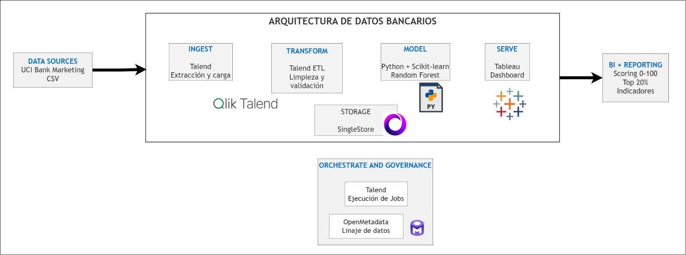
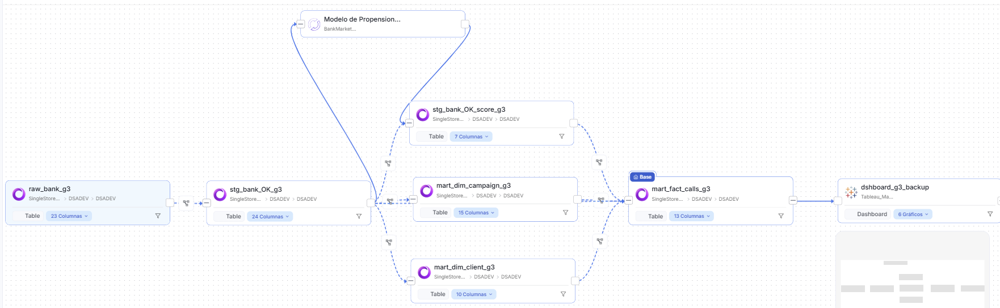

# UCI Bank – Propensión a suscribir

## 1. Problema de negocio

El banco realiza una campaña telefónica para promocionar depósitos a plazo. En campañas anteriores, solo ~11% de las llamadas terminaron en suscripción, lo que significa que la mayoría del esfuerzo se gasta en clientes que dirán que no.
Nuestro producto asigna a cada cliente un score de propensión de 0 a 100 y genera una lista de llamadas con el 20% de clientes con mayor score, para que el banco llame primero a quienes tienen más probabilidad de suscribir.

## Nota: Fuente de datos

Se usará bank-additional-full.csv del UCI Machine Learning Repository (41,188 llamadas, 20 variables + y), en lugar de bank-full.csv (45,211 registros) que indican las instrucciones. Según los autores del dataset, agregar los 5 indicadores económicos (emp.var.rate, cons.price.idx, cons.conf.idx, euribor3m, nr.employed) mejora sustancialmente la predicción, incluso sin usar duration.
Se excluirá la variable `duration` del modelo productivo para evitar fuga de información (_data leakage_), ya que solo se conoce después de realizar la llamada.
Esta decisión tiene dos consecuencias: el archivo no incluye balance, por lo que la regla DQ “balance sin negativos anómalos” no aplica; y pdays usa 999 para “no contactado antes”, que transformaremos a -1 según la regla del reto. No es posible combinar ambos archivos porque no comparten una columna identificadora.

## 3. Arquitectura

La solución sigue la arquitectura lógica de un _Modern Data Warehouse_ (Microsoft, _DataOps Playbook_): los datos pasan por las etapas **Ingest → Transform → Model → Serve**, sobre una capa de **Storage** común y bajo una **orquestación** central.



| Etapa            | Tecnología                                 | Qué hace                                                                                                      | Resultado                                                                                     |
| ---------------- | ------------------------------------------ | ------------------------------------------------------------------------------------------------------------- | --------------------------------------------------------------------------------------------- |
| **Fuente**       | CSV (UCI ML Repository)                    | Archivo `bank-additional-full.csv` (41 188 llamadas, 20 variables + `y`)                                      | —                                                                                             |
| **Ingest**       | Talend Studio                              | Carga el archivo tal como llega, sin modificaciones                                                           | `raw_bank_g3`                                                                                 |
| **Transform**    | Talend Studio                              | Perfilado, eliminación de duplicados (`tUniqRow`) y evaluación de 11 reglas de calidad (`tMap_DQ`)            | `stg_bank_OK_g3` · `stg_bank_NOTOK_g3`                                                        |
| **Model**        | Python (scikit-learn) + SQL en SingleStore | Random Forest que asigna un score de propensión 0–100 y marca el `top20`; construcción del modelo dimensional | `stg_bank_OK_score_g3` · `mart_fact_calls_g3` · `mart_dim_client_g3` · `mart_dim_campaign_g3` |
| **Serve**        | Tableau                                    | Dashboard de priorización de llamadas para el área comercial                                                  | Lista de llamadas top 20 %                                                                    |
| **Storage**      | SingleStore (`DSADEV`)                     | Almacena todas las capas: raw, staging, mart y calidad                                                        | Tablas `*_g3`, `dq_record_g3`, `dq_scorecard_g3`                                              |
| **Orquestación** | Talend Studio                              | `JOB_00_orquestador_UCI_BANK` ejecuta las etapas en orden                                                     | —                                                                                             |
| **Gobierno**     | OpenMetadata                               | Catálogo, glosario de negocio y linaje de los activos (ver §5)                                                | —                                                                                             |

**Fuente del modelo de referencia:** [Exploring the Modern Data Warehouse – Microsoft Learn](https://learn.microsoft.com/en/data-engineering/playbook/solutions/modern-data-warehouse)

## 4. Calidad de datos

## Calidad de datos (DQ)

**Data Steward:** Grupo 3 · **Dataset:** `bank-additional-full.csv` (UCI Bank Marketing, 41 188 registros, 20 variables + `y`)
**Último run medido:** `run_20261107_174849`

### 1. Enfoque

Seguimos el flujo de DAMA-DMBOK (cap. 13): **perfilado → reglas → score → comparación contra umbral**.

1. **Perfilado** (`J01_ingest_raw_bank`, `J02_profile_raw_bank`) sobre la capa raw: nulos, `unknown`, cardinalidad, mín/máx y frecuencias por columna.
2. **Reglas DQ** en `JOB_02_quality` (`tUniqRow` + `tMap_DQ`): cada registro se evalúa contra 11 reglas.
3. **Score por registro** → tabla `dq_record_g3` (1 = cumple, 0 = no cumple, por regla).
4. **Scorecard por regla** → vista `v_dq_scorecard_g3`, guardada en cada ejecución en `dq_scorecard_g3` con su `run_id`, para ver la tendencia entre ejecuciones.

Fórmula (DMBOK, §2.7.2): `% válido = (registros que cumplen / registros evaluados) × 100`.

### 2. Reglas y umbrales

| ID  | Regla                                               | Dimensión   | Umbral   | Por qué este umbral                                                           |
| --- | --------------------------------------------------- | ----------- | -------- | ----------------------------------------------------------------------------- |
| r01 | Los 21 campos no son nulos ni vacíos                | Completitud | 100 %    | Un valor faltante rompe el entrenamiento del modelo                           |
| r02 | Sin registros completamente duplicados (`tUniqRow`) | Unicidad    | 99.5 %   | Los duplicados pueden caer en train y test e inflar el F1                     |
| r03 | `age` entre 18 y 100                                | Rango       | 99.5 %   | Variable de entrada del modelo                                                |
| r04 | `duration` ≥ 0                                      | Rango       | 99 %     | Solo para análisis: **excluida del modelo** (se conoce después de la llamada) |
| r05 | `campaign` ≥ 1 y `previous` ≥ 0                     | Rango       | 99.5 %   | Variable de entrada del modelo                                                |
| r06 | `pdays` ≥ 0 o `999` (= no contactado antes)         | Rango       | 99.5 %   | Variable de entrada del modelo                                                |
| r07 | `y` ∈ {yes, no}                                     | Validez     | 100 %    | Es la variable objetivo: un `y` erróneo enseña respuestas falsas al modelo    |
| r08 | `month` ∈ jan…dec                                   | Validez     | 99.5 %   | Variable de entrada del modelo                                                |
| r09 | `day_of_week` ∈ mon…fri                             | Validez     | 99.5 %   | Variable de entrada del modelo                                                |
| r10 | `poutcome` ∈ {success, failure, nonexistent}        | Validez     | 99.5 %   | Variable de entrada del modelo                                                |
| r11 | `contact` ∈ {cellular, telephone}                   | Validez     | 99.5 %   | Variable de entrada del modelo                                                |
| —   | **Registros que cumplen todas las reglas**          | Global      | **98 %** | Umbral global de calidad del dataset                                          |

Los umbrales se fijaron según el impacto de cada regla en el uso de los datos (el modelo de propensión), como recomienda DMBOK (§2.7.1, reglas "tied to business impact").

### 3. Resultados (`run_20261107_174849`)

| Regla                  | Dimensión   |    Cumplen | Fallan |         % | Umbral | Resultado |
| ---------------------- | ----------- | ---------: | -----: | --------: | -----: | :-------: |
| r01_completitud        | Completitud |     41 176 |      0 |    100.00 |    100 |   PASS    |
| r02_unicidad           | Unicidad    |     41 176 |     12 |     99.97 |   99.5 |   PASS    |
| r03_edad               | Rango       |     41 171 |      5 |     99.99 |   99.5 |   PASS    |
| r04_duracion           | Rango       |     41 176 |      0 |    100.00 |     99 |   PASS    |
| r05_campania           | Rango       |     41 176 |      0 |    100.00 |   99.5 |   PASS    |
| r06_pdays              | Rango       |     41 176 |      0 |    100.00 |   99.5 |   PASS    |
| r07_objetivo           | Validez     |     41 176 |      0 |    100.00 |    100 |   PASS    |
| r08_mes                | Validez     |     41 176 |      0 |    100.00 |   99.5 |   PASS    |
| r09_dia_semana         | Validez     |     41 176 |      0 |    100.00 |   99.5 |   PASS    |
| r10_poutcome           | Validez     |     41 176 |      0 |    100.00 |   99.5 |   PASS    |
| r11_contacto           | Validez     |     41 176 |      0 |    100.00 |   99.5 |   PASS    |
| **TOTAL registros OK** | Global      | **41 171** |  **5** | **99.99** | **98** | **PASS**  |

**Resumen de los campos clave:** completitud **100 %** · unicidad **99.97 %** · rango **≥ 99.99 %** en todas las reglas.

Conteo del flujo: 41 188 leídos → 41 176 únicos (12 duplicados descartados) → **41 171 OK** (`stg_bank_OK_g3`) + **5 NOTOK** (`stg_bank_NOTOK_g3`).

### 4. Hallazgos del perfilado

- **5 registros con `age` = 17** (mín. del perfil): fallan r03 y van a `stg_bank_NOTOK_g3` con su código de regla, motivo, responsable y estado de remediación.
- **12 duplicados exactos** en las 21 columnas, eliminados por `tUniqRow`. Son registros idénticos; no afirmamos que sean el mismo cliente.
- **`unknown` es una categoría válida del dataset** (`bank-additional-names.txt`), no un nulo: `default` 20.87 %, `education` 4.20 %, `housing` 2.40 %, `loan` 2.40 %, `job` 0.80 %, `marital` 0.19 %. Se conserva como categoría propia.
- **`pdays` = 999 en el 96.32 %** de los registros: significa "no contactado antes", por lo que se valida como valor especial y no como fuera de rango.
- **`month` tiene solo 10 valores**: no hay llamadas en enero ni febrero. La regla r08 acepta los 12 meses, por lo que esto no se considera error.
- **Desbalance del objetivo:** solo el **11.27 %** respondió `yes`, por lo que usamos F1 como KPI.
- **`duration` se excluye del modelo productivo** (solo se conoce después de la llamada, según la documentación del dataset); se mantiene solo para análisis.
- **Variables económicas** (`emp_var_rate`, `cons_price_idx`, `cons_conf_idx`, `euribor3m`, `nr_employed`): se validan por completitud, sin inventar límites de rango.

### 5. Relación con el scoring del modelo

El modelo de propensión (`modelo.py` / `scoring_bank.py`) **solo usa los registros que pasan todas las reglas** (`stg_bank_OK_g3`) y **no usa `duration`**: el script se detiene si la encuentra entre las variables. Los 41 171 registros OK tienen un score 0–100 en `stg_bank_OK_score_g3`, y el 20 % con mayor score queda marcado como lista prioritaria de llamadas (`top20`).

### 6. Objetos en SingleStore (`DSADEV`)

| Objeto              | Qué contiene                                                                                  |
| ------------------- | --------------------------------------------------------------------------------------------- |
| `dq_record_g3`      | Resultado de cada regla por registro (0/1), `rules_passed`, `dq_score`, `dq_status`, `run_id` |
| `v_dq_scorecard_g3` | Vista que calcula el % por regla y lo compara con el umbral                                   |
| `dq_scorecard_g3`   | Scorecard guardado en cada ejecución (histórico por `run_id`)                                 |
| `stg_bank_NOTOK_g3` | Registros rechazados, con código de regla, motivo, responsable y estado de remediación        |

Consultar el último scorecard:

```sql
SELECT * FROM dq_scorecard_g3
WHERE run_id = (SELECT MAX(run_id) FROM dq_scorecard_g3)
ORDER BY regla;
```

### 7. Notas y limitaciones

- `run_id` usa la hora de Ecuador (UTC−5); `load_ts` usa la hora del servidor (UTC).
- En `stg_bank_NOTOK_g3`, `codigo_regla` guarda **la primera** regla que falla. El detalle completo de todas las reglas por registro está en `dq_record_g3`.
- La unicidad se mide antes del tMap con los contadores de `tUniqRow`, por eso se agrega al scorecard en un paso aparte (`tDBR_SCORECARD`).

## 5. Linaje y catálogo

### 5.1. Catálogo de datos en OpenMetadata

Se utilizó **OpenMetadata 1.12.6** para centralizar los metadatos, documentar los activos y registrar sus relaciones de linaje. Esta herramienta constituye la capa de **catálogo y gobierno de datos** del proyecto, permitiendo conocer el origen, las dependencias y los responsables de la información.

Se configuró el dominio **Marketing Bancario** y se registró el producto de datos **Sistema de Priorización de Contactos Bancarios**, con el identificador `Priorizacion_Contactos_Bancarios_G3`.

El producto reúne **9 activos técnicos principales**:

| Tipo                       | Activos                                                                                                                                          |
| -------------------------- | ------------------------------------------------------------------------------------------------------------------------------------------------ |
| Tablas de SingleStore      | `raw_bank_g3`, `stg_bank_OK_g3`, `stg_bank_NOTOK_g3`, `stg_bank_OK_score_g3`, `mart_dim_client_g3`, `mart_dim_campaign_g3`, `mart_fact_calls_g3` |
| Modelo de Machine Learning | `bank_marketing_random_forest_g3`                                                                                                                |
| Dashboard de Tableau       | `dshboard_g3_backup`                                                                                                                             |

Adicionalmente, se creó un glosario de negocio con términos como **Campaña**, **Conversión**, **Decil**, **Perfil de cliente** y **Predicción**, para facilitar la interpretación de los datos.

### 5.2. Servicios registrados

Para integrar los metadatos de las diferentes herramientas se configuraron los siguientes servicios:

| Servicio         | Nombre en OpenMetadata          | Propósito                                          |
| ---------------- | ------------------------------- | -------------------------------------------------- |
| Base de datos    | `SingleStore_BankMarketing`     | Catalogar las tablas de la base de datos `DSADEV`. |
| Pipelines        | `talend_studio_bank_g3`         | Documentar los procesos de integración y scoring.  |
| Machine Learning | `BankMarketing_ML_G3`           | Registrar el modelo Random Forest.                 |
| Dashboard        | `Tableau_Marketing_Bancario_G3` | Catalogar el dashboard publicado en Tableau.       |

La extracción de metadatos de Tableau se realizó mediante un agente de ingesta. El modelo de Machine Learning y las relaciones de linaje adicionales se registraron utilizando scripts de Python y la API REST de OpenMetadata.

### 5.3. Pipelines y transformaciones

Se registraron pipelines para documentar los procesos que intervienen en la transformación de los datos.

| Pipeline                 | Descripción                                                                                                       |
| ------------------------ | ----------------------------------------------------------------------------------------------------------------- |
| `LOAD_FACT_CALLS_G3`     | Integra los registros preparados, los resultados del scoring y las dimensiones para construir la tabla de hechos. |
| `PYTHON_BANK_SCORING_G3` | Representa el proceso de inferencia que aplica el modelo Random Forest y genera las puntuaciones de propensión.   |

Los pipelines permiten asociar las relaciones de linaje con los procesos responsables de transformar la información.

### 5.4. Linaje de datos

El linaje documentado permite rastrear las dependencias entre los activos desde las capas de preparación hasta el consumo en Tableau.

**Etapa 1. Preparación y calidad**

Los datos originales se almacenan en `raw_bank_g3`. Después de aplicar las reglas de calidad, los registros se separan en:

- `stg_bank_OK_g3`: registros válidos.
- `stg_bank_NOTOK_g3`: registros rechazados.

**Etapa 2. Modelo de Machine Learning**

Se registró el modelo `bank_marketing_random_forest_g3` como activo de Machine Learning.

El linaje conecta la tabla `stg_bank_OK_g3` con el modelo y relaciona su salida con `stg_bank_OK_score_g3`, donde se almacenan los resultados del scoring.

También se documentó el pipeline `PYTHON_BANK_SCORING_G3`, correspondiente a la ejecución del proceso predictivo en Python.

**Etapa 3. Construcción de la tabla de hechos**

Se registraron las siguientes dependencias hacia `mart_fact_calls_g3`:

- `stg_bank_OK_g3` → `mart_fact_calls_g3`
- `stg_bank_OK_score_g3` → `mart_fact_calls_g3`
- `mart_dim_client_g3` → `mart_fact_calls_g3`
- `mart_dim_campaign_g3` → `mart_fact_calls_g3`

Estas relaciones se asociaron al pipeline `LOAD_FACT_CALLS_G3`.

**Etapa 4. Visualización en Tableau**

Finalmente, se registró la conexión:

`mart_fact_calls_g3` → `dshboard_g3_backup`

Esta relación permite identificar la tabla de SingleStore que alimenta el dashboard de Tableau y consultar sus dependencias desde OpenMetadata.

### 5.5. Registro del linaje mediante Python

Para registrar las relaciones que no se detectaron automáticamente, se desarrollaron scripts de Python utilizando la biblioteca `requests` y la API REST de OpenMetadata.

El procedimiento fue el siguiente:

1. Autenticación mediante un token configurado en la variable de entorno `OM_TOKEN`.
2. Consulta de los identificadores de tablas, pipelines, modelo y dashboard.
3. Registro de las relaciones fuente-destino mediante el endpoint `PUT /api/v1/lineage`.
4. Verificación de las respuestas de la API.
5. Validación visual de las conexiones en la pestaña **Linaje** de OpenMetadata.

De esta forma, se documentaron las dependencias sin modificar los datos originales ni los resultados del modelo.

### 5.6. Gobierno y responsabilidades

Se creó el equipo **Bank Marketing - Grupo 3**, asociado al dominio Marketing Bancario.

El equipo permite organizar a los integrantes del proyecto y establecer responsabilidades sobre los activos catalogados.

Se registró el rol **Data Steward** para apoyar las actividades de documentación, mantenimiento del catálogo y seguimiento de la calidad de datos.

La asignación de equipos y propietarios complementa el linaje, ya que facilita identificar quién es responsable de atender incidencias o revisar cambios en los activos.

### 5.7. Validación y resultados

Se verificó la implementación desde las vistas de catálogo y linaje de OpenMetadata.

Los principales resultados fueron:

- **9 activos técnicos principales** incorporados al producto de datos.
- Dominio y producto de datos registrados.
- Glosario de negocio documentado.
- Pipelines de transformación y scoring registrados.
- Modelo Random Forest catalogado y conectado mediante linaje.
- Tabla de hechos conectada con el dashboard de Tableau.
- Relaciones fuente-destino verificadas visualmente.

La implementación cumple el criterio de **linaje en catálogo**, al contar con datasets de entrada documentados, pipelines registrados con sus transformaciones y más de tres activos conectados.

Además, el linaje facilita el **análisis de impacto**, permitiendo identificar qué activos podrían verse afectados por cambios en una tabla o proceso

**Evidencia. Linaje hasta Tableau**



## 6. Modelo de scoring y KPI

### Modelo predictivo de propensión bancaria – Random Forest

### 1. Descripción del proyecto

Se desarrolló un modelo de aprendizaje automático utilizando el dataset **UCI Bank Marketing**, con el objetivo de predecir la probabilidad de que un contacto bancario contrate un depósito a plazo fijo.

El propósito del modelo es apoyar las decisiones comerciales del banco, identificando los contactos con mayor probabilidad de suscripción y permitiendo priorizar aquellos que podrían generar mejores resultados durante las campañas.

### 2. Preparación y exploración de datos

Se trabajó con **41.171 registros**, analizando la estructura del dataset, los tipos de variables, los valores faltantes y la distribución de la variable objetivo `y`, que representa si el cliente contrató (`yes`) o no contrató (`no`) el depósito.

Se identificó un desbalance de clases, debido a que aproximadamente el 88,74% de los registros corresponde a clientes que no contrataron el producto.

Durante el preprocesamiento se realizaron las siguientes actividades:

- Limpieza y normalización de variables.
- Tratamiento de valores faltantes y de la variable `pdays`.
- Aplicación de **One-Hot Encoding** para transformar las variables categóricas en numéricas.
- Exclusión de `duration`, porque la duración de la llamada únicamente se conoce después del contacto.

Se utilizaron **20 variables predictoras originales**, transformadas en 63 características después de aplicar One-Hot Encoding.

También se realizó un **análisis de correlación** antes y después de la codificación para identificar variables relacionadas con la suscripción. Se experimentó con la selección de las variables más correlacionadas; sin embargo, esta reducción no produjo una mejora consistente del F1-score, por lo que se decidió conservar todas las variables predictoras.

### 3. Experimentación y selección del modelo

Se realizaron diferentes experimentaciones utilizando algoritmos de clasificación, entre ellos:

- HistGradientBoosting.
- Random Forest normal y con balanceo de clases.
- Gaussian Naive Bayes.
- Redes neuronales MLP.

Durante estas pruebas se modificaron hiperparámetros, se evaluaron estrategias de balanceo y se compararon diferentes conjuntos de variables.

En uno de los experimentos, al incluir `duration`, se obtuvo un F1-score aproximado de **0.64**. Sin embargo, se descartó esta configuración como solución operativa porque dicha variable no está disponible antes de realizar la llamada.

Entre las configuraciones evaluadas sin `duration`, se seleccionó **Random Forest con pesos de clase personalizados**, que alcanzó un F1-score de **0.5229**. Este resultado superó ligeramente el F1 de 0.5099 obtenido anteriormente con HistGradientBoosting.

Los ajustes adicionales no generaron mejoras consistentes, por lo que se mantuvo esta configuración como modelo definitivo.

### 4. Entrenamiento y configuración

Se dividieron los datos de manera estratificada:

- **80% para entrenamiento:** 32.936 registros.
- **20% para prueba:** 8.235 registros.

El modelo Random Forest fue configurado con los siguientes hiperparámetros:

| Hiperparámetro      | Valor        |
| ------------------- | ------------ |
| `n_estimators`      | 250          |
| `max_depth`         | 20           |
| `min_samples_split` | 12           |
| `min_samples_leaf`  | 6            |
| `max_features`      | sqrt         |
| `criterion`         | gini         |
| `class_weight`      | `{0:1, 1:5}` |
| `random_state`      | 42           |

Se asignó un peso cinco veces mayor a los registros de la clase positiva para dar más importancia a los clientes que sí contrataron el depósito.

Adicionalmente, se utilizó validación cruzada estratificada de cinco particiones para seleccionar un **umbral de clasificación de 0.5167**, buscando mejorar el equilibrio entre Precision y Recall.

### 5. Evaluación y resultados

El modelo se evaluó sobre los 8.235 registros reservados para prueba.

| Métrica      |  Resultado |
| ------------ | ---------: |
| Accuracy     |     87.83% |
| Precision    |     46.80% |
| Recall       |     59.22% |
| **F1-score** | **0.5229** |
| ROC-AUC      |     0.8049 |
| PR-AUC       |     0.4770 |

El **F1-score de 0.5229** representa el equilibrio entre Precision y Recall para identificar correctamente a los clientes que sí contrataron el depósito.

Este resultado significa que el modelo consigue una capacidad moderada de detección de suscriptores, aunque todavía presenta falsos positivos y no identifica todos los casos positivos.

Posteriormente, se generó un **scoring de propensión entre 0 y 100**, utilizado para ordenar los contactos según su probabilidad estimada de suscripción.

Al seleccionar el 20% de contactos con mayor puntuación, se obtuvo un **Lift@20% de 3.31**, lo que indica que este grupo concentró una tasa de suscripción 3.31 veces superior a la tasa general del conjunto de prueba.

### 6. Modelo guardado y predicciones futuras

El modelo entrenado se guardó en `RandomForest_balanceado.joblib`, junto con su preprocesamiento, para reutilizarlo sin necesidad de entrenarlo nuevamente.

A partir de este archivo se pueden generar nuevas probabilidades de suscripción, calcular el scoring y seleccionar los contactos prioritarios utilizando datos con las mismas variables de entrada.

Los resultados también se exportaron a archivos CSV para su visualización en Tableau.

### 7. Conclusión

Se desarrolló un modelo **Random Forest con ponderación personalizada de clases**, seleccionado después de comparar diferentes algoritmos, hiperparámetros y estrategias de preparación de datos.

Aunque se consiguieron resultados superiores al incluir la duración de la llamada, se decidió excluir esta variable para mantener la aplicabilidad del modelo en la priorización de contactos antes de realizar las llamadas.

El modelo definitivo alcanzó un **F1-score de 0.5229**, que refleja un equilibrio moderado entre identificar suscriptores reales y evitar predicciones positivas incorrectas. Este valor no representa el porcentaje de clientes que contratarán, sino una medida del desempeño de clasificación.

El principal aporte del modelo es la generación de un **scoring de propensión de 0 a 100**, que permite priorizar el 20% de contactos con mayor probabilidad estimada de suscripción y apoyar las decisiones comerciales mediante un dashboard en Tableau.

## 7. Hallazgos

## 8. Cómo ejecutar el pipeline

### 8.1. Ejecución del proceso en Talend

La ejecución del pipeline se realiza desde **Talend Studio 8.0.1**, mediante el job orquestador `JOB_00_orquestador_UCI_BANK`, que coordina las diferentes etapas del procesamiento.

**Pasos de ejecución:**

1. Abrir el proyecto en Talend Studio y localizar el job `JOB_00_orquestador_UCI_BANK`.
2. Verificar la conexión con la base de datos y los parámetros de configuración.
3. Ejecutar el job orquestador mediante la opción **Run**.
4. Esperar a que finalicen los procesos de carga, validación, scoring y construcción del modelo dimensional.
5. Verificar los resultados en la base de datos `DSADEV`.

### 8.2. Flujo de procesamiento y tablas generadas

El job orquestador ejecuta las siguientes etapas:

| Etapa                    | Proceso                                                                                                                                     | Resultado                                                           |
| ------------------------ | ------------------------------------------------------------------------------------------------------------------------------------------- | ------------------------------------------------------------------- |
| 1. Carga RAW             | Extrae el archivo original y almacena los registros sin aplicar modificaciones.                                                             | `raw_bank_g3`                                                       |
| 2. Calidad de datos      | Aplica las reglas DQ, elimina duplicados y clasifica los registros según su cumplimiento.                                                   | `stg_bank_OK_g3` y `stg_bank_NOTOK_g3`                              |
| 3. Scoring               | Ejecuta el script Python, carga el modelo previamente entrenado (`.joblib`) y calcula la propensión de suscripción de cada registro válido. | `stg_bank_OK_score_g3`                                              |
| 4. Modelo dimensional    | Construye las dimensiones de clientes y campañas, y la tabla de hechos para el análisis.                                                    | `mart_dim_client_g3`, `mart_dim_campaign_g3` y `mart_fact_calls_g3` |
| 5. Calidad y seguimiento | Almacena los resultados de las reglas por registro y el resumen de calidad de cada ejecución.                                               | `dq_record_g3` y `dq_scorecard_g3`                                  |

El proceso Python utiliza el modelo entrenado y guardado en formato Joblib para generar un score de propensión de 0 a 100, una clasificación predictiva y un indicador `top20`, que identifica al 20 % de registros con mayor puntuación.

### 8.3. Consultas de verificación

Una vez finalizada la ejecución, se pueden utilizar las siguientes consultas SQL para verificar los resultados.

**Datos originales y registros procesados**

```sql
-- Cantidad de registros originales
SELECT COUNT(*) FROM raw_bank_g3;

-- Registros válidos
SELECT * FROM stg_bank_OK_g3;

-- Registros rechazados
SELECT * FROM stg_bank_NOTOK_g3;
```

## 9. Equipo y roles

| Integrante      | Rol                                      | Responsabilidades (según el kickoff del Datatón)                                                                                                                          |
| --------------- | ---------------------------------------- | ------------------------------------------------------------------------------------------------------------------------------------------------------------------------- |
| Joe Concha      | Data Analyst                             | Construye el modelo analítico en SingleStore (consultas, vistas), el dashboard o análisis, y define los KPIs para el Demo Day.                                            |
| Maricris Orozco | Data Engineer (entrenamiento del modelo) | Desarrolla y entrena el modelo de propensión, y genera el scoring 0–100 y la lista de llamadas prioritarias.                                                              |
| Ariel Navarro   | Data Engineer                            | Construye los jobs de ingesta en Talend Studio, configura los contextos de entorno, aplica las transformaciones `tMap` y asegura el flujo hacia SingleStore.              |
| Ximena Paguay   | Data Steward                             | Define las reglas de calidad (completitud, unicidad, rango, formato), documenta el linaje en el catálogo y certifica que los datos cumplen el umbral de calidad acordado. |

## 10. Próximos pasos
